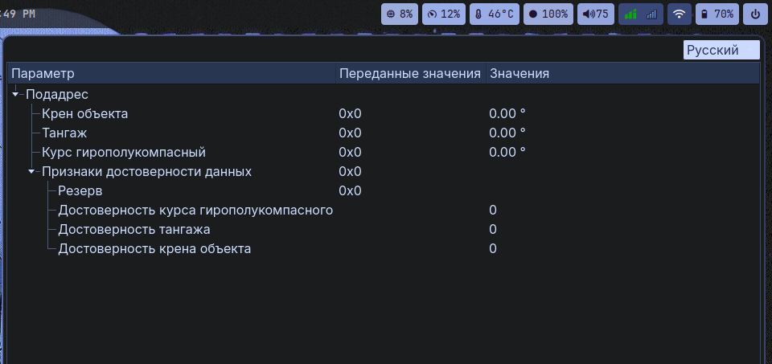
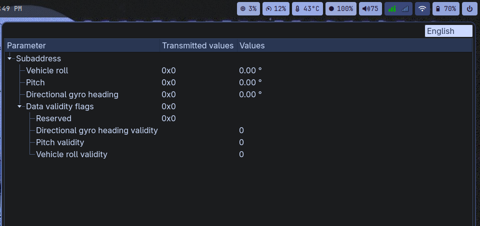

Краткое описание принципа работы:
TranslatableTreeView наследник QTreeView. Работает с любой моделью и любым QTranslator.

1. Между моделью и деревом стоит прокси-модель (QIdentityProxyModel). Для Qt::DisplayRole она возвращает tr(текст).
2. При установке или снятии QTranslator Qt рассылает QEvent::LanguageChange. По этому событию класс заново раскладывает дерево, поэтому обновляются и тексты, и ширина колонок.
3. Тексты, для которых нет перевода, выводятся как есть. Раскрытые и свернутые узлы при смене языка не меняются.

В демо английский перевод задан словарём в main.cpp, но можно было реализовать через отдельный .ts файл и без Qt Linguist

Нужны CMake 3.16+, компилятор с поддержкой C++17 и Qt 5/6

Запуск:

cmake -B build
cmake --build build
./build/TranslatableTreeView

тестировалось на arch linux
